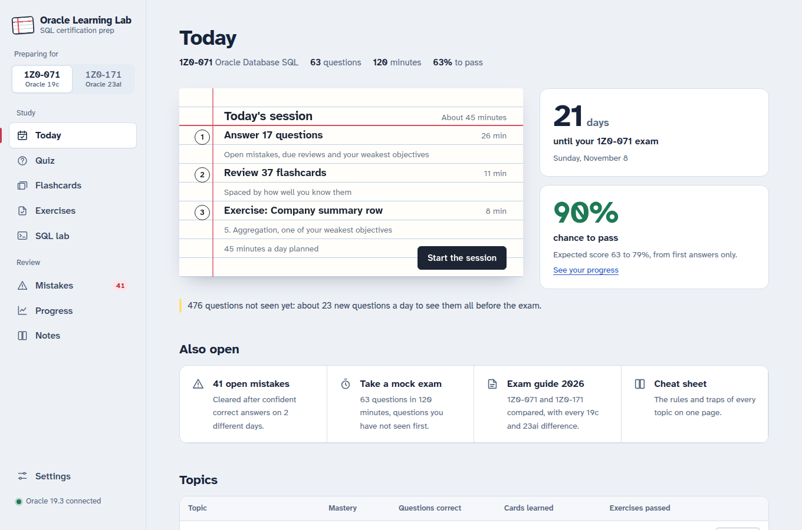
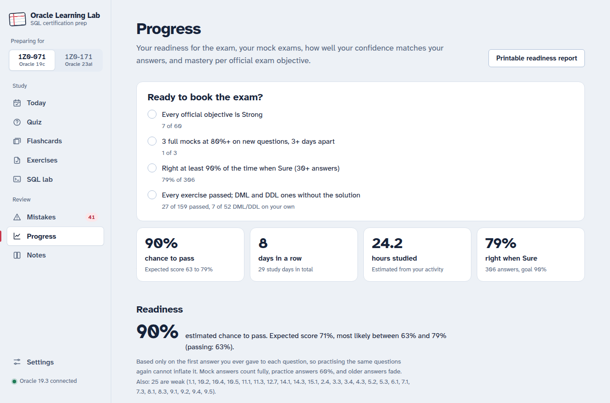
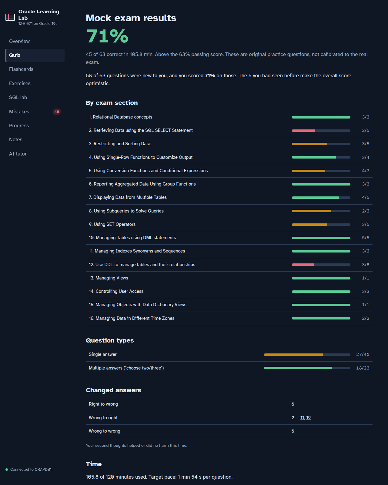
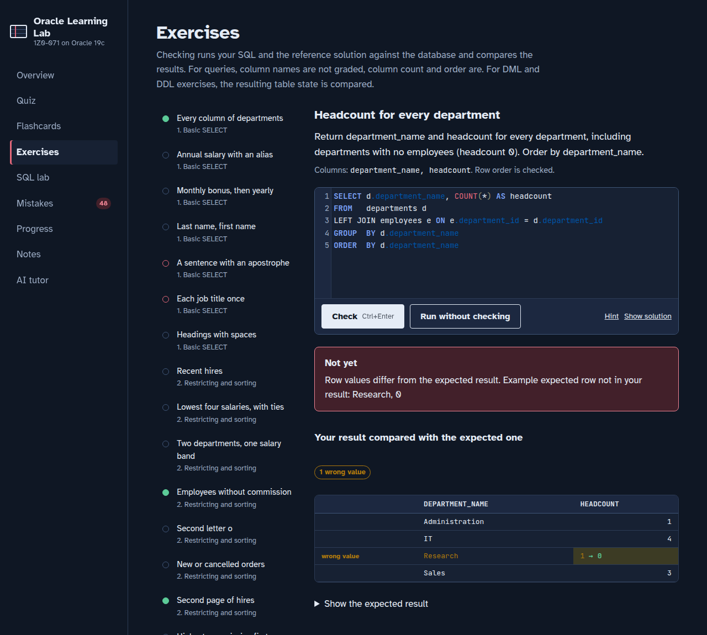
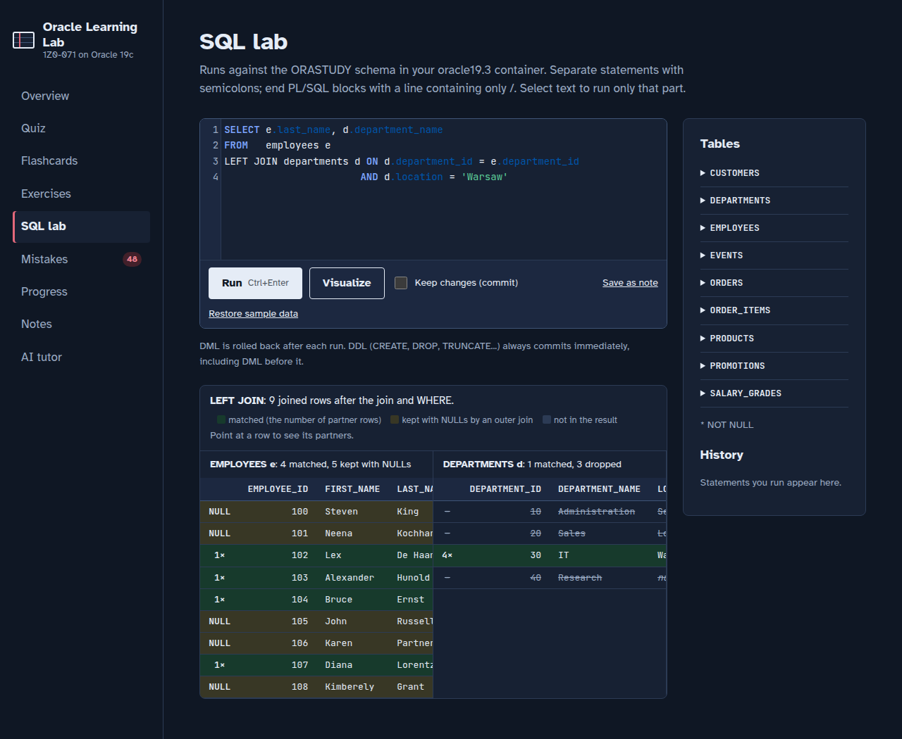
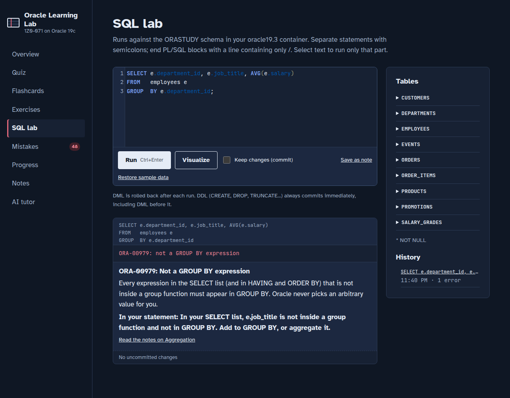
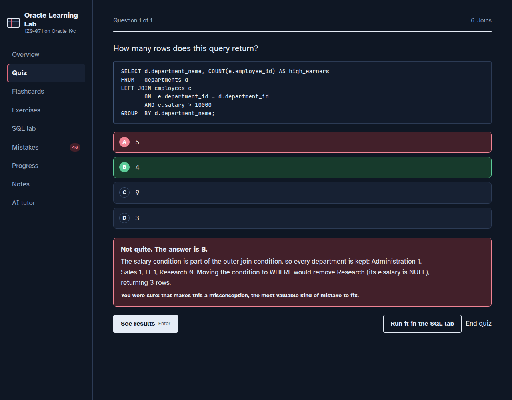

# Stepwise (1Z0-071 and 1Z0-171)

*Stepwise is a working name (set with `STUDY_APP_NAME`); the project was called Oracle Learning Lab.*

A local web app for the Oracle SQL certification exams, **1Z0-071** (Oracle Database SQL, 19c) and
**1Z0-171** (Oracle AI Database SQL Associate, 23ai), that grades your SQL against a real Oracle
database and measures your readiness without letting you fool yourself.

## What makes it different

- **Two exams, one app.** Pick 1Z0-071 or 1Z0-171 in the exam drop-down at the top of the menu: each track has its
  own question pool, objectives, mock exams (63 questions / 63% or 60 questions / 65%) and readiness.
  Topic 15 covers the SQL new in 23ai (BOOLEAN, IF [NOT] EXISTS, GROUP BY alias, VALUES constructor,
  UPDATE/DELETE with joins, domains, annotations, schema privileges, VECTOR search). Questions whose
  answer changed in 23ai are shown on 1Z0-071 only. With a second database (`STUDY_DSN_23AI`) the
  SQL lab and the grader use Oracle 23ai together with the track.
  To add an exam or a database engine, see "Adding an exam" in
  [`AUTHORING.md`](src/oracle_lab/content/AUTHORING.md).
- **Answers are checked by Oracle, not by memory.** 750 original practice questions, 430 of them
  verified on every run by executing SQL, on Oracle 19c for the 1Z0-071 track and Oracle 23ai for 1Z0-171: the correct option must equal the query result, the
  error a statement raises must be the stated ORA- code, and the options of "which queries are
  equivalent" questions are executed and compared. Running the content this way caught real
  factual errors that had been written with confidence (listed in [plan.md](plan.md)).
- **169 graded SQL exercises**: queries graded on their rows, DML graded on the resulting table
  state inside a rolled-back transaction, and DDL graded over the data dictionary. 19 of them are
  "Fix the bug" exercises that start from a statement with a classic exam trap in it.
- **366 flashcards**, an exam guide comparing 1Z0-071 and 1Z0-171 with every 19c/23ai difference
  verified, a one-page cheat sheet, and notes for all 15 topics with a "23ai differences" section.
- **Honest readiness**: the pass estimate uses only the *first* answer you ever gave to each
  question, mock exams prefer questions you have never seen and report your score on those,
  and a correct guess counts as a gap until you prove it on two different days.
- **An SQL lab that teaches**: plain-language explanations of 61 Oracle errors with a hint about
  *your* statement, before/after views of DML with transaction state and savepoints, and a
  visualizer that shows which rows a join matched, kept with NULLs, or dropped.

| | |
|---|---|
|  |  |
| Readiness dashboard: checklist, pass chance, trend, objective map, badges | Mock exam report: sections, answer changes, timing, confidence |
|  |  |
| A failed exercise compared row by row with the expected result | Which rows an outer join matched, kept with NULLs, or dropped |
|  |  |
| An Oracle error explained, with a hint about the statement | Checking an answer by saying how sure you are |

Screenshots use a simulated study history (`oracle-lab demo`). The printable readiness report is
shown in [docs/screenshots/readiness-report.png](docs/screenshots/readiness-report.png).

## Quick start with Docker

One container runs Oracle Database 19c and the app. The database files and your progress live in
`./data` on the host, and the passwords in `./secrets`. You need Docker with Compose v2 and an
Oracle 19c base image built from [oracle/docker-images](https://github.com/oracle/docker-images)
(Oracle publishes no pullable 19c image).

    cp .env.example .env     # set ORACLE_BASE_IMAGE to your 19c image
    make up                  # generates ./secrets, builds, starts; the first start creates the database (10-30 min)
    make logs

Then open http://localhost:8071 and register an account: the first one becomes the administrator
(unless `STUDY_ADMIN_EMAIL` names another) and receives the progress of an earlier single-user version.
For details (credentials, data folders, 23ai, the app-only image), see [docs/docker.md](docs/docker.md).

## Run against your own Oracle database

Requirements: Python 3.12 or later (tested with 3.14), Oracle Database 19c (the content targets 19c; XE 21c also passes
all checks), and a learning user with CREATE SESSION, TABLE, VIEW, SEQUENCE and SYNONYM.

    make venv                                     # .venv with the app (editable) and the dev tools
    echo 'the-password' > ~/.orastudy_pwd && chmod 600 ~/.orastudy_pwd
    .venv/bin/oracle-lab init-db                  # once: creates the sample tables if they are missing
    .venv/bin/oracle-lab serve                    # then open http://127.0.0.1:8071

The server listens on 127.0.0.1 only, because the SQL lab runs any SQL you type. Open it at the
host of `STUDY_PUBLIC_URL` (here `http://127.0.0.1:8071`; in the Docker setup `http://localhost:8071`):
Google sign-in redirects back to exactly that address. Passwords are read
from files (`*_FILE`) rather than from the code or the command line. Settings:

| Variable | Default | Meaning |
|---|---|---|
| `STUDY_DSN` | `localhost:1521/ORAPDB1` | Database to connect to |
| `STUDY_USER` | `orastudy` | Learning user |
| `STUDY_PASSWORD_FILE` | `~/.orastudy_pwd` | File holding its password (`STUDY_PASSWORD` also works, e.g. in CI) |
| `STUDY_HOST`, `STUDY_PORT` | `127.0.0.1`, `8071` | Where the app listens |
| `STUDY_DATA_DIR` | `~/.local/share/oracle-learning-lab` | Your progress (`progress.json`) and saved notes (`notes/`) |
| `STUDY_STATE_FILE` | `$STUDY_DATA_DIR/progress.json` | Progress file, if it should live elsewhere |
| `STUDY_STATE_USER`, `STUDY_STATE_PASSWORD_FILE` | – | Keep progress and saved notes in this Oracle user's tables instead of files (for hosts without a disk, see [docs/docker.md](docs/docker.md#only-the-app-external-database)) |
| `STUDY_STATE_DSN` | `STUDY_DSN` | Its database |
| `STUDY_PUBLIC_URL` | `http://HOST:PORT` | Address users open the app at; `https://` turns on secure cookies |
| `STUDY_TRUST_PROXY` | off | `1` behind a reverse proxy: believe `X-Forwarded-For` (needs an `https://` `STUDY_PUBLIC_URL`) |
| `STUDY_ADMIN_EMAIL`, `STUDY_ADMIN_PASSWORD_FILE` | – | The administrator account (default: the first user to register); set `STUDY_ADMIN_PASSWORD`, or sign in with Google using that address |
| `STUDY_GOOGLE_CLIENT_ID`, `STUDY_GOOGLE_CLIENT_SECRET_FILE` | – | Turn on "Sign in with Google" |
| `STUDY_APP_NAME` | `Stepwise` | The product name on every page |
| `STUDY_REGISTRATION`, `STUDY_MAX_USERS` | `open`, `25` | Allow sign-ups; cap on accounts |
| `STUDY_PROVISIONER_USER`, `STUDY_PROVISIONER_PASSWORD_FILE` | – | Oracle user that creates private practice schemas |
| `STUDY_GATEWAY_USER`, `STUDY_GATEWAY_PASSWORD_FILE` | – | Proxy user the app connects through (`CREATE SESSION` only) |
| `STUDY_PRACTICE_TABLESPACE`, `STUDY_PRACTICE_QUOTA_MB` | `USERS`, `50` | Where a practice schema lives and its quota |
| `STUDY_DSN_23AI` | – | Optional Oracle 23ai database used while the 1Z0-171 track is chosen |
| `STUDY_USER_23AI`, `STUDY_PASSWORD_23AI_FILE` | the 19c user and password | Its learning user |

### Accounts

The app has sign-up and sign-in (e-mail and password, optionally Google). Progress, notes and SQL
history are per user, and with the provisioner and gateway users set, each user works in a private
practice schema, so dropping a table in the SQL lab never affects anyone else. The Docker setup
creates both users itself; for your own database and for Google sign-in see
[docs/docker.md](docs/docker.md#accounts-and-google-sign-in), and for upgrading an existing
installation [docs/docker.md](docs/docker.md#upgrading-an-existing-deployment). Without them,
learners cannot run SQL ("not set up"); only administrators use the shared schema. The old single `STUDY_AUTH_*` login is gone.

Learning happens in **workspaces**, one per certification track (today "Oracle SQL · 1Z0-071" and
"Oracle SQL · 1Z0-171"). On the first visit a new account picks one from a grid of tiles; it becomes their
**free** workspace and the default. Access is per workspace:

| Access | What it includes |
| --- | --- |
| Free (one workspace per user) | A daily allowance of quiz questions and flashcards (20 and 20 by default), the first 2 topics' lessons and the exam guide, mistakes, progress and personal notes. Exercises, the SQL lab and mock exams are shown locked as Premium. |
| Subscribed | Everything in that workspace: SQL exercises, the SQL lab, mock exams, every lesson, no daily limits. |

Other workspaces stay visible in the "Preparing for" drop-down, greyed out as needing a subscription. Account
roles are just **User** and **Administrator**; administrators use every workspace. On the Admin page an
administrator grants or removes access (Manage → Workspaces: No access / Free / Subscribed), moves a user's free
workspace, and sets the free plan's limits under Sign-up. Payments are not built yet: subscriptions are given by
an administrator. The server enforces all of it; the pages only follow.

The full list, with validation, is in [src/oracle_lab/config.py](src/oracle_lab/config.py).

## Features

- **Quiz**: practice with immediate explanations, or timed mock exams (63 or 60 questions, 120 minutes,
  one question per objective first, review screen before submitting). Filter by question type
  (choose two/three, which error, predict the output, equivalent queries, read the code, concepts)
  and by unseen questions; in exam mode a filtered set becomes a timed drill.
- **Confidence and calibration**: rate each answer Sure / Think so / Guessing (keys S, T, G);
  the app tracks how often you are right when you are sure.
- **Learning engine** (`study/engine.py`): SM-2 spacing for flashcards and questions, mistakes that
  need confident correct answers on two days, mastery per official objective, interleaved
  practice, and a daily plan sized to your exam date and study time.
- **Readiness**: pass probability with a score range, a "ready to book" checklist, mock trend,
  objective heatmap, study streak and hours, evidence-based badges, and a printable
  readiness report at `/report`.
- **Exercises**: query, DML, DDL and "Fix the bug" exercises with two levels of hints, a row-by-row
  diff, and filters by topic, kind and status.
- **Flashcards**: spaced repetition per topic, all due cards, or a deck from your weakest topics.
- **SQL lab**: CodeMirror editor with Oracle SQL highlighting and table/column autocomplete,
  run selection, error explanations, DML before/after, join and set-operator visualizer,
  query history, and "save as note".
- **Notes** for all 15 topics, with common traps, Oracle vs. standard SQL and 23ai differences,
  plus the exam guide 2026 and the cheat sheet (linked from Today).
- **Interface**: works on desktop and phone, light and dark themes, full keyboard use (option
  numbers, S/T/G, Enter, Space and 1/2/3 for flashcards), and no build step.

- **English and Polish**: switch the whole app (interface, server messages, questions, exercises,
  flashcards, notes, error explanations and the printable report) in Settings, in the sidebar, or on
  the sign-in pages. The choice is saved to the account, and a browser in Polish starts in Polish.
  SQL, ORA- error texts and exam names stay as they are. Translations live next to their source:
  `content/i18n/<lang>/` overlays, `.pl.md`/`.pl.sql` note siblings, `analysis/i18n/pl.json` for
  error explanations, and `i18n/pl.json` / `resources/static/i18n/pl.json` for the server and
  interface texts. `oracle-lab validate --static --lang pl --complete` and
  `tests/test_translation_coverage.py` fail on any gap; `content/AUTHORING.md` has the rules.

## Develop

    make check                                  # ruff + content structure + pytest (database tests skip if Oracle is down)
    .venv/bin/oracle-lab validate --coverage    # check all content against the database
    STUDY_DSN=localhost:1522/FREEPDB1 STUDY_PASSWORD_FILE=~/.orastudy23_pwd .venv/bin/oracle-lab validate  # 1Z0-171 items on 23ai
    .venv/bin/oracle-lab demo /tmp/demo.json    # simulated progress for screenshots
    STUDY_STATE_FILE=/tmp/demo.json .venv/bin/oracle-lab serve

To write questions, flashcards and exercises, see [src/oracle_lab/content/AUTHORING.md](src/oracle_lab/content/AUTHORING.md).
CI ([.github/workflows/ci.yml](.github/workflows/ci.yml)) runs the lint, the tests and the content checks
against Oracle XE 21c and Oracle 23ai Free.

### Architecture

The front end talks to a JSON API, and the API is served by layers that depend only on the layers
below them:

    src/oracle_lab/
    ├── cli.py              `oracle-lab` command: serve, init-db, validate, demo, healthcheck
    ├── bootstrap.py        composition root: the only module that picks concrete classes
    ├── config.py           Settings from the environment (frozen dataclasses, validated)
    ├── credentials.py      Secret: passwords from *_FILE / Docker secrets, read on demand, never logged
    ├── web/                HTTP adapter
    │   ├── http.py         Request / Response / HttpError (no sockets)
    │   ├── routing.py      Router; controllers register their own routes
    │   ├── middleware.py   access log, error boundary, basic auth, same-origin check
    │   ├── controllers/    one per area: study, mock exams, SQL lab + exercises, notes, health
    │   ├── static.py       the single-page front end
    │   ├── report.py       printable readiness report
    │   └── server.py       ThreadingHTTPServer adapter with graceful shutdown
    ├── services/           use cases: StudyService, MockExamService, SqlLabService, ExerciseService
    ├── study/              domain: engine (spacing, mastery, readiness, mocks), recording rules,
    │                       mock exams, exam tracks, notes library, StateStore (atomic JSON file)
    ├── grading/            run submissions and solutions, compare results row by row
    ├── database/           connections and the per-track DatabaseCatalog, script runner,
    │                       value formatting, schema browser, sample schema (init and reset)
    ├── analysis/           Oracle error explanations, join and set-operator visualizer
    ├── sqltext/            pure SQL text helpers: statement splitter, clauses, SQL*Plus messages
    ├── content/            questions, flashcards, exercises (one module per topic), objectives
    ├── tools/              content validator, demo history
    └── resources/          static/ (front end, ES modules, no build step), sql/ (sample schema), notes/
    tests/                  pytest suite (unit, HTTP end to end, and database tests)
    docker/                 container entrypoint, health check, ORASTUDY provisioning, app-only image

Every service gets what it needs through its constructor, such as a `StateStore`, a `DatabaseCatalog`
or a clock. The tests can therefore swap in an in-memory store or a fixed time.

## Articles

- [Grading SQL against a real database](docs/articles/grading-sql-against-a-real-database.md)
- [Measuring exam readiness without fooling yourself](docs/articles/measuring-readiness-without-fooling-yourself.md)

The roadmap and what is still open are in [plan.md](plan.md). All questions are original
practice material written for this project, not real exam questions.

## Credits

Technology logos on the workspace tiles come from [Simple Icons](https://simpleicons.org) (CC0 1.0). The names and
logos are trademarks of their owners and are shown only to name the technology; "coming soon" tiles have no content yet.
